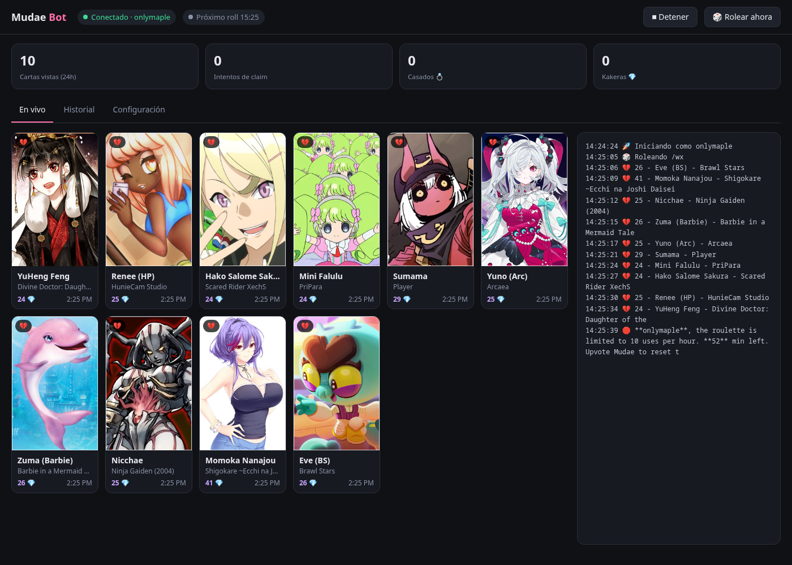
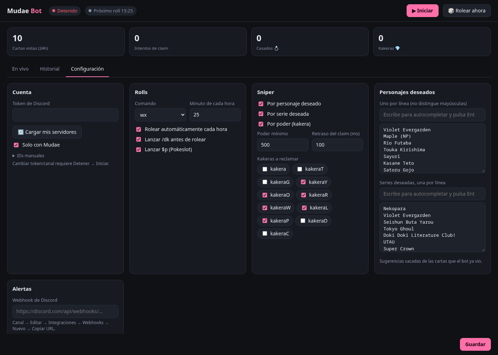

# Mudae Self Bot

### by GDiazFentanes (Original Project) – Updated by Maple

## Introduction

This project started as a **fork** of [GDiazFentanes’ original Mudae bot](https://github.com/GuilleDiazFentanes/AutoClaim-AutoRoll-AutoReact-MudaeBot-2025), which crashed on my setup.
It has since been rewritten: everything now runs from a small **web panel** (no more editing `Vars.py`), with a live card feed, history and alerts.

With it, the bot can:

* Automatically roll and claim Mudae characters (waifus, husbandos) and kakera
* Snipe cards from other users’ rolls if they match your desired characters/series or pass a power threshold
* Keep a searchable history of everything it saw, tried to claim and married

> [!CAUTION]
> Self-bots break Discord's Terms of Service and can get your account banned. Use it on an account you're OK risking.

## Features

* **Web control panel** (`http://127.0.0.1:8765`): start/stop, roll now, live status and next roll time
* **Live feed** of every card Mudae shows in your channel, **with the card image**, power and claimed status
* **History** of claim attempts, marriages and kakera grabs (stored in `mudae.db`), searchable and filterable
* **Alerts** via **Discord webhook** and/or **Telegram bot** (both free) on claim attempt, marriage, kakera and disconnect
* **Auto roll** every hour in a random window after the minute you choose. It checks `$tu` first, rolls exactly what you have left, and only runs `/dk` / `$daily` + `$rolls` when they're ready (+ `$p` optional)
* **Auto badges** (optional): spends kakera on the cheapest affordable badge level (Bronze/Silver/Gold first, which unlocks Sapphire/Ruby/Emerald)
* **Kakera stock** tracked over time in `mudae.db`
* **Randomized timing** on rolls, claims and kakera clicks so it doesn't act like a metronome
* **Sniper** for any roll in the channel: by desired character > series > power threshold (case-insensitive)
* **Auto kakera** for the kakera types you pick
* Uses slash commands for native boosts (10% extra Kakera)

## Screenshots





## Files

| File             | Purpose                                                       |
| ---------------- | ------------------------------------------------------------- |
| `app.py`         | Run this. Starts the bot and the web panel                    |
| `mudae.py`       | Bot logic: sniper, roller, history, alerts                    |
| `ui.html`        | The panel                                                     |
| `config.json`    | Your settings (created/edited from the panel, git-ignored)    |
| `test_mudae.py`  | Quick self-check: `python test_mudae.py`                      |

## Requirements

* **Python 3.13+**
* `pip install -r requirements.txt` (Discum + Requests)

> [!IMPORTANT]
> Before using the bot, you must run the `$help` command in your server once.
> This unlocks Mudae's **slash commands**, which are required for the bot to function correctly.

## How to Use

```bash
pip install -r requirements.txt
python app.py
```

Open **http://127.0.0.1:8765** (the panel is in Spanish) → **Configuración**, fill in your token, server ID and channel ID, save, and press **Iniciar**.
Everything else (roll command, minute, desired characters/series, kakeras, power threshold, alerts) is set from the same page and applies live.

### Alerts

* **Discord:** channel → Edit → Integrations → Webhooks → New Webhook → copy URL → paste in the panel.
* **Telegram:** create a bot with [@BotFather](https://t.me/BotFather), send it any message, get your chat ID from [@userinfobot](https://t.me/userinfobot), paste both in the panel.
* Use **"Guardar y enviar prueba"** to check it works.

The panel only listens on `127.0.0.1` (your token is in it), so don't expose it to the internet.

### Possible Errors

> [!WARNING]
> Most issues come from missing Mudae toggles or a wrong channel/server ID. Check the panel's log (right side of **En vivo**) first.

* Mudae has no permission to read/write in the chosen channel
* Discord token may have changed
* Your account must have DMs with Mudae enabled

> [!IMPORTANT]
> The following **must** be enabled in Mudae for the bot to work properly:
>
> * `$togglestatistics`
> * `$togglekakstats`
> * `$togglekakerarolls`
